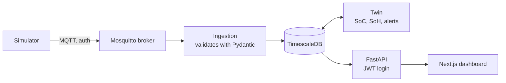

# Battery Digital Twin

[](https://github.com/Farhat-Iqbal/battery-twin/actions/workflows/ci.yml)

A digital twin of a single battery cell. A simulator streams sensor data over MQTT, a twin service estimates state of charge (SoC) and state of health (SoH) and flags voltage anomalies, and a secured API feeds a live Next.js dashboard. All services run in Docker Compose.

> **This is a demonstrator, not a production system.** All data is simulated, there is one cell, and the SoH model is trained on a public lab dataset (NASA PCoE, cell B0005).

## Demo

[https://github.com/user-attachments/assets/89981ebf-0370-4918-9184-3987479294fb]

## Architecture



| Service | What it does |
| --- | --- |
| `simulator` | Publishes voltage, current and temperature once per second. Cycles between discharge and charge. Press Enter to inject a 10-second fault (overheating and voltage drop). |
| `mosquitto` | MQTT broker with username/password authentication (`allow_anonymous false`). |
| `ingestion` | Subscribes to `battery/+/telemetry`, validates each message with Pydantic and stores it in the `readings` hypertable. |
| `timescaledb` | PostgreSQL with TimescaleDB. Hypertables: `readings`, `twin_state`. Plain table: `alerts`. Created from `db/init.sql` on first start. |
| `twin` | Estimates SoC by Coulomb counting, computes the expected voltage, and raises an alert when the residual (measured minus expected) exceeds 0.1 V. Predicts SoH with a regression model. Resumes SoC and ageing from the database after a restart. |
| `api` | FastAPI with JWT authentication. |
| `dashboard` | Next.js, Tailwind and Recharts: KPI cards, measured vs expected voltage chart, alerts list, 2-second refresh. |

## How the twin works

- **SoC:** Coulomb counting, `SoC += current * dt / capacity` (capacity 2.5 Ah).
- **Expected voltage:** `3.0 + SoC/100 * 1.2 - current * R0` with `R0 = 0.05 ohm`.
- **Anomaly:** an alert is raised when `|measured - expected| > 0.1 V`.
- **SoH:** a degree-2 polynomial regression on capacity-fade data from the NASA PCoE Li-ion battery dataset (cell B0005; Saha and Goebel, 2007), tracked with MLflow. MAE is about 0.026 Ah, roughly 1.4% of nominal capacity.

## Quick start

Requirements: Docker Desktop.

1. Copy `.env.example` to `.env` and fill in every value. Use `POSTGRES_USER=twin` and `POSTGRES_DB=batterytwin`. Choose unique, random values for the passwords and for `JWT_SECRET`. `.env` is git-ignored; never commit it.
2. Create the MQTT user (first time only; the broker needs this file to start):

   ```bash
   docker run --rm -it -v ./mosquitto/config:/mosquitto/config eclipse-mosquitto:2 mosquitto_passwd -c /mosquitto/config/passwd twinuser
   ```

   Use the same password as `MQTT_PASSWORD` in `.env`.
3. Start everything:

   ```bash
   docker compose up -d --build
   ```

4. Run the dashboard (it is not containerised yet):

   ```bash
   cd dashboard
   npm install
   npm run dev
   ```

   Open http://localhost:3000 and log in as `admin` with your `ADMIN_PASSWORD`.

Ports are bound to `127.0.0.1` only: MQTT 1883, TimescaleDB 5433, API 8000.

## API

| Method and path | Auth |
| --- | --- |
| `GET /health` | public |
| `POST /auth/login` | public, returns a JWT (60 minutes) |
| `GET /cells/{cell_id}/latest` | Bearer token |
| `GET /cells/{cell_id}/history` | Bearer token |
| `GET /alerts` | Bearer token |

## Security

- MQTT broker requires authentication; no anonymous access.
- API uses JWT (PyJWT, HS256) with bcrypt-hashed admin password; the dashboard keeps the token in memory only.
- Secrets live in `.env`, which is git-ignored. Compose refuses to start if a required variable is missing.
- Containers run as a non-root user and ports are bound to localhost.
- CI (GitHub Actions) runs pytest, Bandit, pip-audit, `npm audit` (production dependencies) and `npm run build` on every push.

## Tests

```bash
pip install -r requirements.txt
pytest
```

9 tests cover API authentication and ingestion validation.

## Known limitations

- Data is simulated; there is one cell, not a pack.
- The voltage model is a simple linear approximation, not a chemistry-based model.
- The SoH model is trained on one NASA cell and is not validated for other cell types.
- The single `admin` user is hard-coded for demo purposes. A real system would store hashed users in the database and support roles.
- MQTT runs without TLS.
- If the simulator is restarted on its own, its internal SoC resets and the twin raises false alerts until their states line up again.
- The dashboard is not containerised yet.

## Planned (not built yet)

- Batch analytics layer: load all four NASA cells, SQL analytics tables, scheduled pipeline (Airflow), transformations and data-quality tests (dbt), an Analytics page in the dashboard.
- Admin-only fault injection from the dashboard, JWT roles, MQTT TLS, image scanning in CI.
- A read-only AI assistant that answers questions from the database.

## License

MIT
